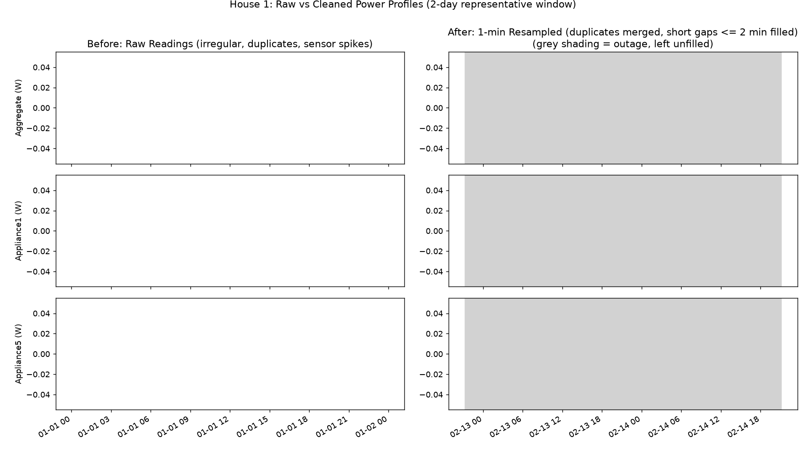

# DATA: coverage, quality, and cleaning

## Dataset facts

- **REFIT Electrical Load Measurements**, University of Strathclyde: 20 UK households, whole-home (aggregate) power plus up to 9 individually monitored appliances per home, collected over roughly two years.
- **Units:** watts (active power). **Nominal sampling:** about 8 seconds, but readings are irregular (see below).
- **Raw files used:** House 1 only (Section 1).
- **Cleaned files used:** the houses listed in `washer_availability` below (Sections 2-3).

✏️ TODO: confirm "20 households", the date range and the units against `CLEAN_READ_ME_081116.txt` and write the exact first/last dates of the data you used.

## Section 1: raw House 1, inspection findings

<!-- TABLE:raw_quality -->
<!-- /TABLE -->

Per-channel checks (missing readings, negatives, impossible values, appliance readings above the aggregate):

<!-- TABLE:raw_channels -->
<!-- /TABLE -->

✏️ TODO: summarise in 4-6 bullets what you actually found (ordering, duplicates, irregular intervals, extremes, missing). Use the numbers above.

## Cleaning steps (in order)

1. Parse timestamps; rows that cannot be parsed are dropped and counted.
2. **Impossible values** (negative, or above 25 kW) set to missing.
3. **Duplicate timestamps:** merged by the mean. Rationale: the two rows describe the same instant, so averaging is more neutral than choosing one; the number of conflicting duplicates is reported above.
4. **Sort** by time.
5. **Resample** to 1-minute means; minutes with no readings stay missing.
6. **Short gaps (≤ 5 min):** linear interpolation. A 5-minute gap is shorter than almost any real change in a household's load pattern that matters here, and interpolating does not invent cycles.
7. **Long gaps (> 5 min):** left empty and flagged in an `outage` column. They are never filled, and are excluded from training and scoring.

Before/after plot: `results/figures/01_raw_before_after.png`

✏️ TODO: one or two sentences on what the plot shows (what the extreme values did before cleaning, how outages appear after).

## Sections 2-3: cleaned data

- The official cleaned files are used as provided, then handled the same way (1-minute mean, short-gap fill, long gaps left empty). Rows with the official `Issues` flag set are masked.
- Availability of each washer channel:

<!-- TABLE:washer_availability -->
<!-- /TABLE -->

Houses dropped by the washer-channel sanity check:

<!-- TABLE:excluded_houses -->
<!-- /TABLE -->

## Remaining concerns

- **Timestamp time zone** is assumed (UTC → London). A wrong assumption shifts hour-of-day patterns by an hour in summer.
- **Appliance-channel mapping** comes from the readme and was checked only by a simple sanity rule.
- **Interpolated minutes** in the aggregate are not real measurements; they are a small share of the data (see tables).
- **Outage periods** mean the number of cycles per week is computed over valid time only.
- **Meter vs sub-meter mismatch:** appliance readings can occasionally exceed the aggregate in the raw data (counted above), which suggests small timing or calibration differences between sensors.
- Households are volunteers in the UK; they are not representative of other countries.

✏️ TODO: add anything else you noticed that is specific to your run.
