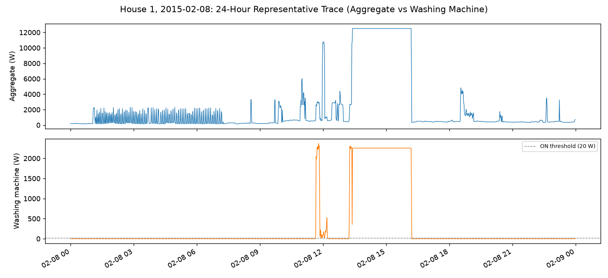
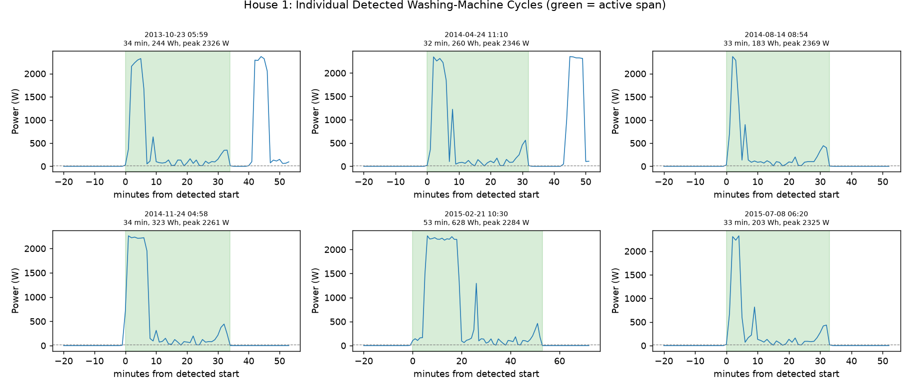
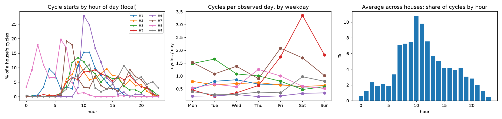
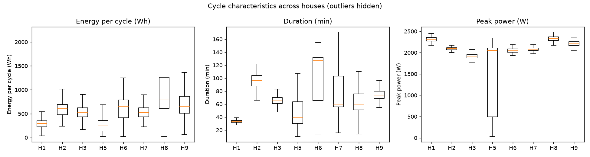
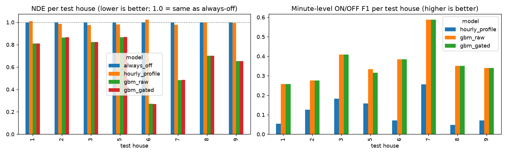
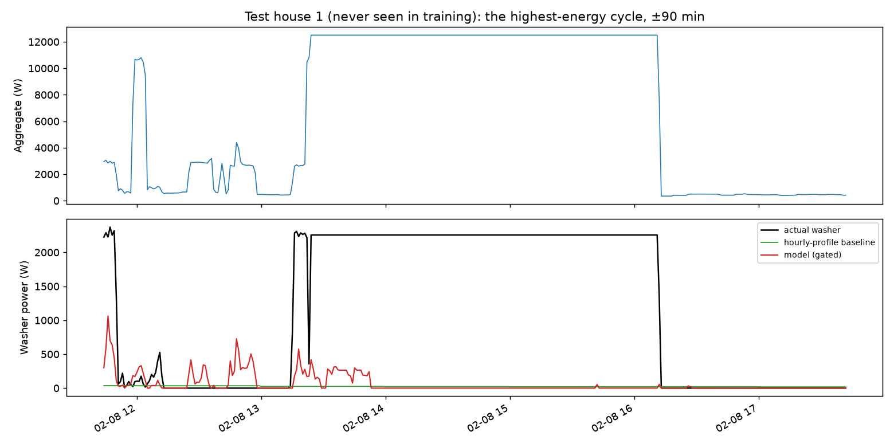
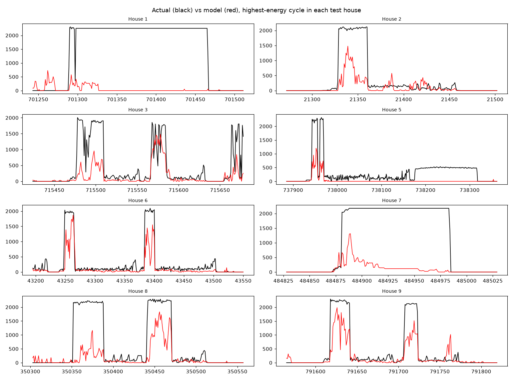
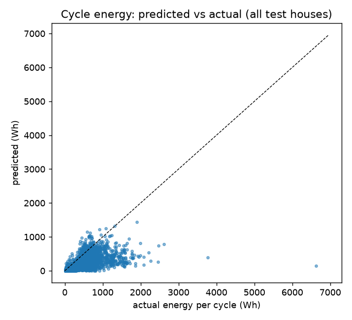
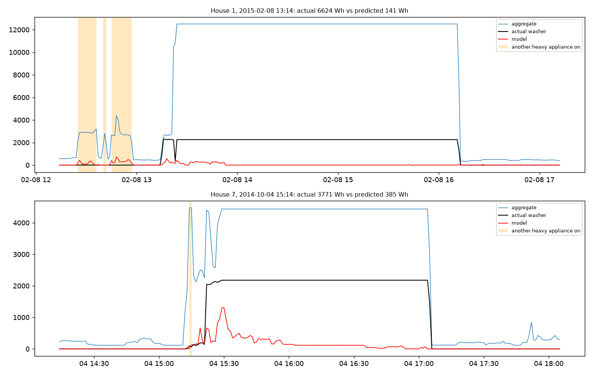
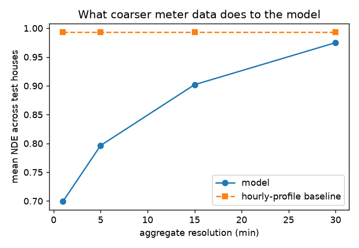

# Results: Washing-Machine EDA and Energy Disaggregation

This report presents the exploratory analysis of washing-machine electricity consumption, model evaluation on unseen households, prediction errors, failure cases, and the effect of lower smart-meter sampling resolution. Numerical tables are generated by `python -m src.run_all` and should be interpreted alongside the corresponding figures.

## 1. Washing-Machine Exploratory Data Analysis

### 1.1 Households and Data Availability

The analysis uses the eligible REFIT households listed below. Availability varies by household because of differences in recording periods, missing observations, and data quality.

<!-- TABLE:washer_availability -->
<!-- /TABLE -->

These differences matter when comparing households: a household with fewer valid observations or fewer complete washing cycles provides less evidence for estimating its usage patterns.

### 1.2 Washing-Cycle Detection Rule

A candidate washing cycle starts when the washer's power exceeds **20 W**. Inactive gaps of up to **5 minutes** are merged into the same cycle, provided the gap does not contain missing data. A candidate must last at least **10 minutes** and consume at least **20 Wh** to qualify as a cycle.

Cycles that overlap missing-data gaps are excluded from cycle statistics because their duration and energy may be incomplete. All thresholds are configured in `src/config.py`.

### 1.3 Representative-Day Analysis

The representative day illustrates the relationship between aggregate household demand and the washing-machine channel. Comparing the two signals helps establish when washer activity contributes to the whole-home load and how difficult it may be to isolate the appliance.

Interpretation should focus on:
- Whether washer activity coincides with visible increases in aggregate demand.
- The washer's power relative to the total household load.
- Other changes in aggregate demand that cannot be attributed to the washer alone.

The selected day is a representative visualization chosen by the analysis procedure; it should not automatically be interpreted as the household's average day.

### 1.4 Detected Washing Cycles

The detected-cycle plot illustrates how the threshold and duration rules segment washer activity. Washing cycles can contain periods of high power, lower-power operation, and temporary inactivity.

Threshold-based detection is useful for identifying candidate cycles, but it does not guarantee that every cycle boundary is correct. Low-power programmes may be missed, while unrelated power events may occasionally resemble appliance activity. Missing readings can also truncate otherwise valid cycles.

### 1.5 Usage Patterns by Hour and Day

The hourly and day-of-week analysis examines whether washing-machine activity varies with time. These patterns may inform customer insights and demand-flexibility programmes, but any apparent morning, evening, weekday, or weekend preference should be confirmed against the generated plots and household-level summaries.

The observed patterns describe the households in this dataset; they should not be generalized to all UK households or other populations without further validation.

### 1.6 Cross-Household Comparison

<!-- TABLE:cycle_stats_by_house -->
<!-- /TABLE -->

Cycle statistics allow comparisons of usage frequency, duration, energy, and power characteristics across households. Differences may reflect household routines, washing-machine models, selected programmes, recording coverage, or data-quality issues.

Household rankings and specific differences should be interpreted using the table above rather than assuming that a particular household has higher consumption or longer cycles without checking the results.

### 1.7 Concurrent Operation of Other Appliances

<!-- TABLE:concurrency -->
<!-- /TABLE -->

Concurrent operation matters because the aggregate signal contains the combined demand of multiple appliances. When a washing machine operates alongside another high-power appliance, its contribution can be harder to distinguish. The concurrency results provide context for interpreting model errors and identifying situations that may require additional features or more sophisticated disaggregation methods.

## 2. Washing-Machine Disaggregation Model

### 2.1 Experimental Setup

The task is to estimate washing-machine power in watts for each minute using the aggregate household electricity signal as the model input.

The evaluation uses a **leave-one-household-out (LOHO)** design. Each eligible household is held out as the test household once, while the remaining households provide training and validation data.

<!-- TABLE:split_design -->
<!-- /TABLE -->

The model-selection procedure uses a time-ordered validation block from the training households. Hyperparameters and the optional ON/OFF gate are selected using validation data, not the held-out test household.

<!-- TABLE:tuning_choices -->
<!-- /TABLE -->

The models evaluated are:

- **`always_off`:** predicts zero washer power at every minute.
- **`hourly_profile`:** predicts washer power using hour-of-day averages derived from training households.
- **`gbm_raw`:** predicts washer power using a `HistGradientBoostingRegressor`.
- **`gbm_gated`:** applies an ON/OFF threshold to the gradient-boosting predictions.

The model uses aggregate power and engineered temporal features. Other appliance channels support exploratory analysis but are not used as prediction inputs.

**Validation caveat:** centered rolling windows and future-looking features can expose observations near a temporal split boundary to information from later timestamps. To guarantee strict temporal separation, features should be constructed within each split or boundary observations should be purged. The use of future readings also makes the current feature design suitable for offline analysis rather than causal, real-time inference.

### 2.2 Evaluation Metrics

| Metric | Interpretation |
|---|---|
| MAE (W) | Average absolute minute-level power error. |
| RMSE (W) | Penalizes large prediction errors more strongly than MAE. |
| SAE | Relative error in estimated appliance energy. |
| NDE | Normalized disaggregation error; values below 1 indicate improvement over a zero prediction under the stated normalization. |
| Precision | Fraction of predicted ON minutes that are truly ON. |
| Recall | Fraction of actual ON minutes correctly detected. |
| F1-score | Harmonic mean of precision and recall. |
| Cycle recall and false cycles | Assess whether actual cycles are detected and how many spurious cycles are predicted. |

No single metric is sufficient. For example, a model can achieve a relatively low MAE by predicting near-zero power most of the time because the washer is inactive for many minutes. Energy-based and ON/OFF metrics help reveal this limitation.

### 2.3 Overall Model Results

The following table reports mean and standard deviation across the held-out households.

<!-- TABLE:metrics_summary -->
<!-- /TABLE -->

The results should be interpreted jointly across power error, energy error, and ON/OFF detection. The always-off and hourly-profile baselines provide reference points for determining whether the model learns useful appliance-specific patterns.

A model should not be described as universally superior merely because it achieves the best average value for one metric. Its relative performance across households, cycle-level errors, and the variability of the reported metrics also matter.

### 2.4 Per-Household Results

<!-- TABLE:metrics_per_house -->
<!-- /TABLE -->

#### Test-Set Characteristics

<!-- TABLE:test_sizes -->
<!-- /TABLE -->

The per-household results show how performance varies across held-out homes. Differences can arise from the number of valid test minutes, the number of complete washing cycles, the washer's share of total household energy, and the similarity between the test household and the training households.

Households with few cycles or a small washer-energy share can present a more difficult estimation problem because the appliance signal is less frequent or less prominent in the aggregate load.

Use the reported values to identify where the model improves on both baselines, where it approaches baseline performance, and where it performs poorly. The standard deviation summarizes variation across households; it is not by itself a confidence interval.

### 2.5 Actual Versus Predicted Power

The following plot shows a held-out household selected by the evaluation procedure. It is not necessarily the best-performing household.

The next figure presents results across all test households.

These plots should be used to examine whether predictions follow the timing and magnitude of washer activity. In particular, inspect whether high-power phases align with the actual signal, whether lower-power operating phases are recovered, and whether predictions remain positive when the washer is inactive.

A smooth prediction can capture broad activity while missing short peaks or cycle boundaries. Conversely, excessive positive predictions during inactive periods can increase false positives and energy error.

### 2.6 Cycle-Level Energy Analysis

<!-- TABLE:cycle_energy_error -->
<!-- /TABLE -->

Cycle-level analysis examines whether estimated energy agrees with the energy measured for detected washing cycles. Deviations from the ideal agreement line indicate underestimation or overestimation. The spread of errors is important: good average performance does not guarantee accurate estimates for individual cycles.

The reported cycle-energy error distribution should guide whether the model is appropriate for broad portfolio analysis or whether its cycle-level uncertainty is too large for the intended use.

### 2.7 Failure Analysis

<!-- TABLE:failure_cases -->
<!-- /TABLE -->

Failure cases provide concrete examples of when the model struggles. Potential explanations include overlapping appliance operation, low-power or unusual wash programmes, household-specific operating patterns, missing readings, and differences between washing-machine types.

For each displayed failure, inspect the actual aggregate signal, actual washer power, and predicted washer power before assigning a cause. A plausible explanation is not confirmed merely because it fits the shape of the signal.

Potential next steps include adding carefully validated contextual features, improving cycle-level constraints, testing household-specific calibration, and evaluating alternative sequence models. Each improvement should be compared using the same held-out-household design.

## 3. Effect of Smart-Meter Resolution

The model is retrained and evaluated using aggregate signals averaged over coarser intervals. Washer predictions are then assessed using the evaluation procedure defined by the implementation.

<!-- TABLE:resolution_study -->
<!-- /TABLE -->

At 15- or 30-minute resolution, short power changes are averaged together, making cycle boundaries and high-power phases harder to identify. Individual cycles may span only a few readings, and washer demand can become difficult to distinguish from other household loads.

Coarser data may still support broad estimates of consumption or time-of-day usage, but its suitability for cycle-level inference must be established empirically. The table above should be used to identify the resolution at which the model stops improving on the hourly-profile baseline, if such a point is observed.

## 4. Overall Interpretation

This evaluation investigates whether aggregate household electricity readings contain enough information to estimate washing-machine power across unseen households. The EDA characterizes appliance usage and household variability, while the baseline comparisons and held-out-household metrics assess the value and limitations of the learned model.

The findings should be reported with the observed household-level variation, cycle-energy errors, missing-data constraints, and validation caveat in mind. Before deployment, the feature-generation procedure should be made temporally strict, the main conclusions should be verified against the generated figures and tables, and performance should be independently checked on additional households.

For utility-facing recommendations and deployment considerations, see [Recommendation.md](Recommendation.md).
